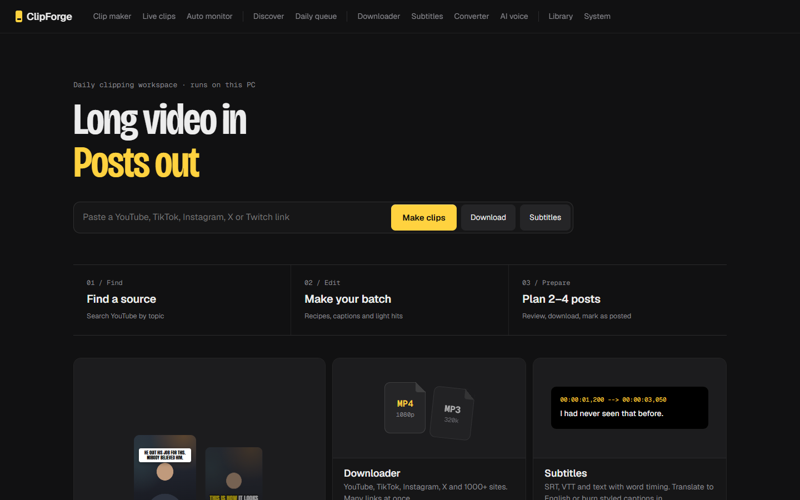
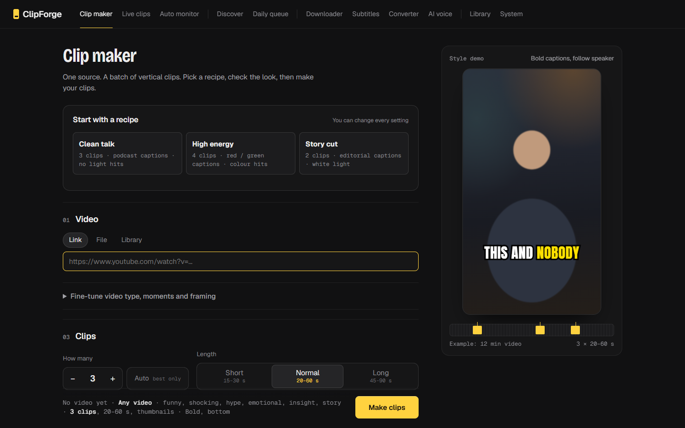
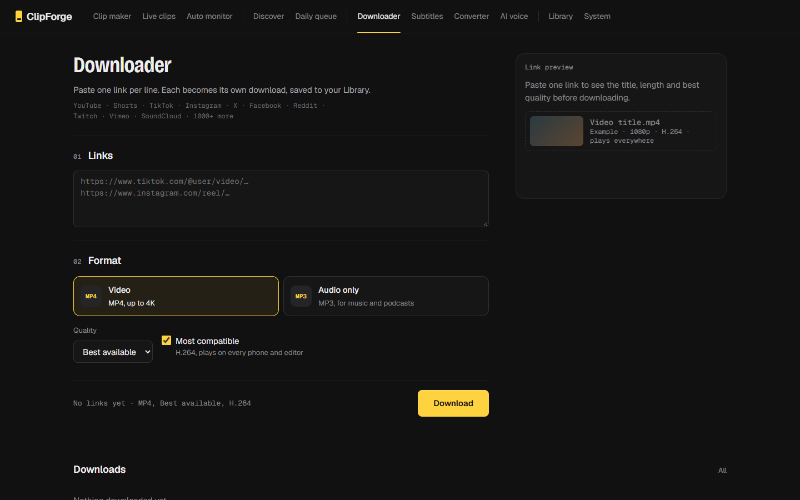
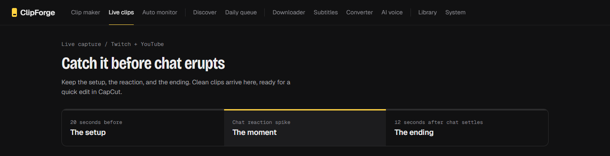

<div align="center">

# ClipForge

**Long video in, posts out.**
A clipping workspace that runs on your own PC. Paste a link, get vertical clips with captions, ready for TikTok, Shorts and Reels.

Windows 10/11 · Linux · Python · FFmpeg · Whisper · runs offline after setup

[](https://github.com/generalworksit/clipforge/stargazers) [](LICENSE) [](https://github.com/generalworksit/clipforge/commits/main)

<picture>
  <source media="(prefers-color-scheme: dark)" srcset="docs/screenshots/home-dark.png">
  
</picture>

</div>

---

## Contents

- [What it does](#what-it-does)
- [Install](#install) · [with your AI agent](#with-your-ai-agent)
- [First clips in 2 minutes](#first-clips-in-2-minutes)
- [Live capture with the Chrome companion](#live-capture-with-the-chrome-companion)
- [Settings](#settings)
- [Troubleshooting](#troubleshooting)
- [Status and limits](#status-and-limits)
- [Related projects](#related-projects)
- [License](#license)

## What it does

| Tool | What you get |
|---|---|
| **Clip maker** | Finds the best moments in a long video, cuts them to 9:16, follows the speaker and adds styled word-by-word captions. Optional thumbnail per clip |
| **Live clips** | Captures YouTube/Twitch reactions. Turn captures or finished replays into 9:16 captioned Shorts, preview and download them in the same page |
| **Gaming layout** | **Auto detect** finds the webcam in a gameplay recording for you, or draw webcam/game regions yourself, preview a vertical stack or camera overlay, save layouts, trim, and export with captions or without |
| **Auto monitor** | Silent YouTube recording without browser tabs. Two simultaneous streams by default, configurable recording limits and independent buffers (experimental) |
| **Publish** | Review clips, connect YouTube, and approve private uploads or scheduled posts. Four uploads per day by default; [setup](docs/publishing.md) |
| **Downloader** | MP4 or MP3 from YouTube, TikTok, Instagram, X, Reddit, Twitch and 1000+ other sites, many links at once |
| **Subtitles** | SRT, VTT or text with word timing, translation to English, burned-in captions, and earlier/later timing adjustments |
| **Converter** | Make vertical (blur or crop), compress to a target size for Discord or WhatsApp, trim, extract MP3, make GIFs |
| **AI voice** | Local text-to-speech for intros and voiceovers |
| **Library** | Everything you made, with preview, save, select and bulk delete |
| **System** | A health check of FFmpeg, Python, packages, disk, GPU, downloader and local AI, with the fix for anything wrong |

Light and dark mode follow your system, or switch with the button in the top bar. Everything runs on `127.0.0.1`. Your videos, keys and settings never leave the PC, and nothing is posted for you.

<table>
<tr>
<td width="50%"><br><sub>Clip maker: recipes, moment types, length and a live style preview</sub></td>
<td width="50%"><br><sub>Downloader: paste many links, pick MP4 or MP3</sub></td>
</tr>
</table>

## Install

You don't need to install anything by hand. The launcher checks your PC and gets what is missing.

### With your AI agent

Paste this into Claude Code, Codex, Cursor or any coding agent that can run commands on your PC:

```text
Install ClipForge for me from https://github.com/generalworksit/clipforge
1. Clone it into my Desktop folder (use my GitHub login if the repo asks for access).
2. Run the installer once without starting the app:
   Windows: run.bat --setup-only        macOS/Linux: ./run.sh --setup-only
   It installs FFmpeg, Python, Node.js and the Python packages by itself.
   Accept any Windows permission prompt. If it fails, read the error,
   fix the cause and run it again. Don't install packages globally.
3. When it prints "Setup complete", tell me the folder path and that I start
   ClipForge by double-clicking run.bat (./run.sh on macOS/Linux).
Do not start the app yourself and do not change any project file.
```

The agent installs everything and stops. You then double-click `run.bat` and the app opens in your browser. The optional local AI question is skipped in this mode; install it later with `winget install Ollama.Ollama`.

Prefer a terminal? One line does the same:

```powershell
git clone https://github.com/generalworksit/clipforge.git "$HOME\Desktop\clipforge"; cd "$HOME\Desktop\clipforge"; .\run.bat
```

### Windows

1. Download the project: **Code → Download ZIP** on GitHub and extract it, or
   ```bat
   git clone https://github.com/generalworksit/clipforge.git
   ```
2. Double-click **`run.bat`**.

That's it. A short window explains what happens, then the first run takes 5 to 15 minutes depending on your connection, later runs start in a few seconds. The browser opens **http://127.0.0.1:8000** by itself.

What the first run does for you:

| Step | How | Needed for |
|---|---|---|
| FFmpeg | installed with `winget` if missing | everything (required) |
| Python 3.12 | installed with `winget` if no Python 3.11 to 3.13 is found | everything (required) |
| Python packages | created in a private `.venv` folder, nothing touches your system Python | everything |
| CUDA libraries | only when an NVIDIA GPU is detected | much faster transcription |
| Node.js LTS | installed with `winget` if missing | Auto monitor only |
| Ollama + qwen3:8b | **asked once**, about 6 GB, skipped after 30 s | smarter moment picking (optional) |
| Whisper and voice models | downloaded the first time a tool needs them | subtitles, clips, AI voice |

Before every start the launcher runs a quick system check (a few seconds) and prints anything that needs attention, with the fix. The same check is on the **System** page.

> [!NOTE]
> Windows may show a permission prompt while installing Python, FFmpeg or Node.js. Accept it and the launcher continues on its own.

### Linux and macOS

```bash
git clone https://github.com/generalworksit/clipforge.git
cd clipforge
./run.sh
```

The first run installs what is missing, like `run.bat` does on Windows:

- **FFmpeg and Node.js** through apt, dnf, pacman or Homebrew. It asks for your password once on Linux.
- **Python 3.12** in a private folder with [uv](https://docs.astral.sh/uv) when your distro only ships a newer Python (Ubuntu 26.04 ships 3.14, which the AI libraries don't support yet). Your system Python is not touched.
- **Python packages** in `.venv`, plus the CUDA libraries when `nvidia-smi` finds an NVIDIA GPU.

Then it opens http://127.0.0.1:8000. Tested on Ubuntu 26.04, including WSL on Windows with the GPU. Ollama is optional: `curl -fsSL https://ollama.com/install.sh | sh`, then `ollama pull qwen3:8b`.

On Linux and macOS the Auto monitor API key is stored in a file only your user can read, since Windows' DPAPI encryption isn't available there. macOS should work the same way but hasn't been tested yet.

### Hardware

| | Minimum | Better |
|---|---|---|
| CPU / RAM | any 64-bit CPU, 8 GB RAM | 16 GB RAM |
| GPU | not required | NVIDIA with 8 GB+ VRAM: Whisper large-v3 and the local AI run on it |
| Disk | 5 GB free | 20 GB+ if you keep many clips or use Auto monitor (needs 8 GB free) |

Without an NVIDIA GPU ClipForge picks the smaller Whisper model and everything still works, only slower.

## First clips in 2 minutes

1. Run `run.bat`, the app opens in your browser.
2. Paste a YouTube, TikTok, Instagram, X or Twitch link on the home page and press **Make clips**.
3. Pick a recipe (**Clean talk**, **High energy** or **Story cut**), or tune the moments, length and caption style yourself.
4. Press **Make clips**. Progress shows at the top of every page.
5. Preview, trim and download each clip from the result page. Everything also lands in **Library**.

## Live capture with the Chrome companion



1. Start ClipForge.
2. Open `chrome://extensions`, turn on **Developer mode**, press **Load unpacked** and choose the `extension` folder.
3. Pin **ClipForge Live** and press **Connect app** in its popup. The connection is saved.
4. Open a livestream with its chat visible and press **Start capture**.

When chat reacts, ClipForge keeps 20 seconds before the moment and 12 seconds after chat settles, and the clip shows up in **Live clips**. **Save moment** (`Alt+Shift+C`) marks one yourself. The extension also lives in its own repo, [clipforge-live](https://github.com/generalworksit/clipforge-live), with the full guide.

## Settings

Defaults work for most people. To change them, copy `config.example.yaml` to `config.yaml` and restart.

| Setting | Default | Why change it |
|---|---|---|
| `server.port` | `8000` | port already in use |
| `whisper.model` | `auto` | `large-v3-turbo` for speed, `small` on a weak PC |
| `moments.provider` | `ollama` | `heuristic` to skip the local AI entirely |
| `video.encoder` | `libx264` | `h264_nvenc` renders much faster on NVIDIA |
| `download.cookies_from_browser` | empty | `firefox`, `chrome` or `edge` for private or age-restricted videos |
| `captions.default_preset` | `bold` | `clean`, `karaoke`, `podcast`, `neon` and 9 others |

Run `run.bat --no-browser` to start without opening a tab, or `run.bat --setup-only` to install everything without starting the app.

## Troubleshooting

<details>
<summary><b>The launcher says winget is not available</b></summary>

Install **App Installer** from the Microsoft Store, then run `run.bat` again. Or install the missing parts yourself: [Python 3.12](https://www.python.org/downloads/) (tick *Add python.exe to PATH*), [FFmpeg](https://www.gyan.dev/ffmpeg/builds/), [Node.js LTS](https://nodejs.org).
</details>

<details>
<summary><b>"Package installation failed"</b></summary>

Usually a dropped connection. Run `run.bat` again, it continues where it stopped. If it keeps failing, delete the `.venv` folder and run it once more for a clean install.
</details>

<details>
<summary><b>Clips are picked without the AI</b></summary>

Ollama isn't installed or running. Install it with `winget install Ollama.Ollama`, then `ollama pull qwen3:8b`. The launcher starts it on every run after that.
</details>

<details>
<summary><b>Transcription is very slow</b></summary>

No NVIDIA GPU was found, so Whisper runs on the CPU. Set `whisper.model: small` or `base` in `config.yaml` for faster results.
</details>

<details>
<summary><b>Port 8000 is already in use</b></summary>

Another ClipForge window is probably still open. Close it, or set another `server.port` in `config.yaml`. If you change the port, enter it in the Chrome companion too.
</details>

<details>
<summary><b>The Chrome companion can't connect</b></summary>

Make sure ClipForge is running, then press **Connect app** again. Reload the extension in `chrome://extensions` after updating ClipForge.
</details>

## Status and limits

- The Chrome companion needs the stream tab open and visible. Ads and overlays inside the player are recorded too.
- **Auto monitor** is experimental, YouTube only, and needs a Google Cloud API key for YouTube Data API v3. Twitch and Kick background capture are not built yet.
- Whisper handles English, French and Russian well. Always review automatic captions before posting.
- Only process media you own or have permission to use.

Recordings, models, keys, cookies and logs stay out of version control. For the code layout and tests see [docs/development.md](docs/development.md).

## Related projects

| | |
|---|---|
|  | **[ClipForge Live](https://github.com/generalworksit/clipforge-live)**. The Chrome extension on its own: clips Twitch and YouTube streams when chat reacts and sends them to ClipForge. Same code as the `extension` folder here |

## Star history

<a href="https://star-history.com/#generalworksit/clipforge&generalworksit/clipforge-live&Date">
 <picture>
   <source media="(prefers-color-scheme: dark)" srcset="https://api.star-history.com/svg?repos=generalworksit/clipforge,generalworksit/clipforge-live&type=Date&theme=dark" />
   <source media="(prefers-color-scheme: light)" srcset="https://api.star-history.com/svg?repos=generalworksit/clipforge,generalworksit/clipforge-live&type=Date" />
   
 </picture>
</a>

The chart updates on its own as people star either repo.

## License

[MIT](LICENSE). Use it, change it, ship it, keep the copyright notice. The bundled fonts in `assets/fonts` and `static/fonts` keep their own open font licenses, included beside each font. Whisper, Kokoro and Ollama models are downloaded from their authors and follow their own licenses.
